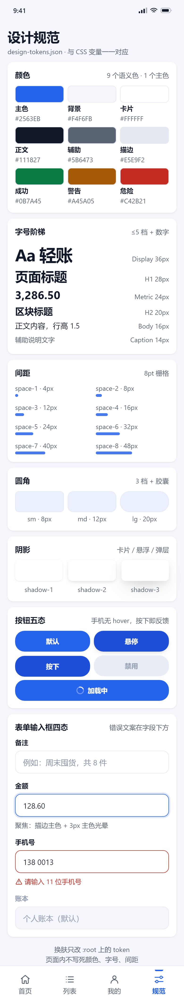

# UI 优先开发流程（给 AI 用的开发规范）

> **起因**：让 AI 开发一个 APK，它没做 UI 设计就直接写代码，成品界面很丑。
> **这套规范的作用**：从今往后，所有带界面的开发都按「先出设计给你过审 → 再写代码」走，**每一关键停下来等你点头**。

`v1.0.0` ｜ 适用于 APK / App / Web / 小程序 / 桌面端 / 管理后台 ｜ 已适配 DSH · Codex CLI · Claude Code

<table>
<tr>
<td></td>
<td></td>
<td></td>
</tr>
<tr><td align="center">可点击原型的首页</td><td align="center">列表页 + 四态切换</td><td align="center">删除前的二次确认</td></tr>
</table>

> 上面三张不是设计概念图，是仓库里那份**可点击原型脚手架**的真实截图（[index.html](templates/prototype/index.html)，单文件、离线可开、可切换空/加载/错误态）。你的项目 P1 阶段交出来的就是这个量级。

---

## 它解决什么

| 常见问题 | 后果 | 本规范的机制 |
| --- | --- | --- |
| 跳过设计直接写代码 | 界面 = 默认控件堆起来的样子 | **P1 设计先行 + 门禁②：UI 没过审不写界面代码** |
| 各页面各自配色、字号随手定 | 越加越乱 | `design-tokens.json` 为唯一取值来源，禁止硬编码 |
| 只做"有数据"的样子 | 空数据/加载/报错是白屏和原生样式 | 每屏必须齐 **默认 / 空 / 加载 / 错误** 四态 |
| 做完才看到成品 | 丑到装机那天才发现 | 每个阶段必须附**真实截图**，不接受口头结论 |

---

## 30 秒安装

### 方式一：说一句话，让 AI 自己装（推荐）

新机器上，对任何 AI（DSH / Codex / Claude Code）说：

> **“把这套 UI 优先开发流程装到这台电脑：https://github.com/ljr282341583/dev-workflow 。装完自己检查三处是否生效，把结果告诉我。”**

AI 会读 [install/AGENT-INSTALL.md](install/AGENT-INSTALL.md) 自己完成（clone → 跑安装脚本 → 自检 → 汇报 ✅/❌）。你不需要敲任何命令。

### 方式二：解压 → 双击（完全离线，不用 git）

1. 下载 [最新安装包](https://github.com/ljr282341583/dev-workflow/releases/latest)（`ui-first-dev-installer-v*.zip`）
2. 解压到桌面
3. **双击「安装.cmd」** → 看到「安装结果」全是 ✅ 就成功了

### 方式三：命令行（自动化 / 技术向）

```powershell
git clone https://github.com/ljr282341583/dev-workflow.git "$env:USERPROFILE\dev-workflow"
powershell -NoProfile -ExecutionPolicy Bypass -File "$env:USERPROFILE\dev-workflow\install\install-machine.ps1"
# 可选：-Target dsh|codex|claude|all ；-DryRun 先看计划 ；-WorkspaceAgents 指定工作区根
```

> 三种方式装的是同一件事：**技能 `ui-first-dev`** + **各工具红线**（`AGENTS.md` / `CLAUDE.md` 追加，改前自动备份）+ **工作区规则 §2.6**（自动探测工作区根）。
> **幂等**：重复装不会重复插入；未安装的工具自动跳过；不覆盖原有设置。

---

## 装完怎么用

对 AI 说一句就行：**「帮我做个 XXX 的 App」**。它不会直接写代码，而是：

| 阶段 | 它做 | 你看到 | 你要做 |
| --- | --- | --- | --- |
| **P0 需求** | 问你 5 个问题（谁用 / 必须有啥 / 不做什么 / 算成功 / 技术栈） | 一页需求卡 `docs/PRD.md` | 确认没理解偏 |
| **P1 UI 设计** ← 最关键 | 出 **2～3 套风格方向** → 你选 → 铺全屏可点击原型 + 设计 token + 每屏截图 | 浏览器/手机能点的原型 | **选方向、过审稿** |
| **P2 前端** | 按原型 1:1 实现，先假数据 | 能跑的前端 + 走查截图 | 看像不像 |
| **P3 后端** | 先定接口契约，再接 mock，再换真接口 | `docs/API-CONTRACT.md` | 确认业务逻辑 |
| **P4 验收** | 真实数据跑主流程、测异常、真机截图 | 验收表（逐条打勾） | 验收 |
| **P5 交付** | 安装包/网址 + README + 收尾笔记 | 能装能用的成品 | 用起来 |

### 你只需要会说这几句

| 你的想法 | 直接说 |
| --- | --- |
| 满意 | **「过」** |
| 局部要改 | **「P1-统计页 筛选太挤，间距改大」** |
| 整体不对味 | **「太花/太素，重出方向」** |
| 拿不准 | **「A 和 B 哪个更适合户外用？你推荐」** |
| 赶时间 | **「先跑起来，设计后面补」**（会记技术债） |
| 不改 | **「这次别走流程，直接写」**（说清后果 + 留痕） |

> 只说「随便 / 你看着办」时，AI 会反问确认，不猜你的审美；你不回复，它不推进。

---

## 流程：六阶段 · 五门禁

```
P0 需求 ──①── P1 UI 设计 ──②── P2 前端(mock) ──③── P3 契约+后端 ──④── P4 验收 ──⑤── P5 交付
              ↑ 门禁②是硬的：UI 没过审，一行界面代码都不写
```

每个阶段结束都按固定格式汇报，**缺产物就不算过门**：

```
【P2 前端实现 · 阶段汇报】
产物：<文件路径 / 链接 / 截图>
结论：<做完了什么、能不能用>
差异/遗留：<与上一阶段不一致处、已知问题>
下一阶段：<阶段名 + 预计做什么>
请你：回复「过」我继续；要改就说屏编号 + 具体哪里不对
```

---

## 你会看到什么（截图证据）

| 设计规范页 | 列表空态 | 列表错误态 |
| --- | --- | --- |
|  |  |  |

色板 / 字号阶梯 / 间距 / 圆角 / 阴影 / 按钮五态 / 输入框四态都在这页；空态有引导、错误态有重试——**空和错也要好看**，这是本规范最容易抓出"丑"的地方。

---

## 仓库结构

```
├─ WORKFLOW.md             主规范：六阶段、五门禁、反丑 10 条、例外通道、目录标准、复盘
├─ CHECKLIST-UI.md         交付前自检：A–G 七组 + 30 秒判丑
├─ README.md               本文件（索引与装法）
├─ 安装.cmd / 安装说明.txt  双击安装入口与小白说明
├─ templates/
│  ├─ PRD.md / UI-DESIGN.md / API-CONTRACT.md / ACCEPTANCE.md
│  ├─ design-tokens.json   设计 token 起点（59 个语义 token）
│  └─ prototype/           可点击高保真原型脚手架（5 屏 + 四态 + 确认弹层 + 表单四态）+ shots/
├─ skill/ui-first-dev/     技能正本（安装时复制到各工具的技能目录）
└─ install/                安装脚本、红线模板、工作区片段、打包脚本、给 AI 的安装说明
```

---

## 支持的工具

| 工具 | 技能目录 | 红线文件 |
| --- | --- | --- |
| DSH | `~\.agents\skills\` | `~\.dsh\AGENTS.md` + 工作区 `AGENTS.md` §2.6 |
| Codex CLI | `~\.codex\skills\` | `~\.codex\AGENTS.md` |
| Claude Code | `~\.claude\skills\` | `~\.claude\CLAUDE.md` |
| Cursor / Zed 等 | 无统一目录 | 读项目根 `AGENTS.md`（agents.md 标准），把本规范挂进项目即可 |

规范正文是**纯 Markdown / HTML**，与工具无关；工具之间差的只是"谁会自动加载它"。

---

## 常见问题

**Q：每次都走全流程会不会太慢？**
A：小改动有快捷通道（[WORKFLOW.md](WORKFLOW.md) 第 5 节）：修 bug / 改文案直接改（附截图）；单屏小改先出该屏截图。只有「新项目 / 新页面 / 换整体风格」才走全流程——恰恰是这三类返工最贵。

**Q：我不懂设计，怎么审？**
A：所以 P1 是给你 2～3 套方向**让你选**，不是拿一套稿子让你评价。还有 5 个傻瓜问题兜底："第一眼最该看到的是不是最显眼？有没有挤成一团/空得奇怪？同一个按钮长得一样吗？空/加载/报错长什么样？数字一眼看得懂吗？"

**Q：安装会不会覆盖我原来的配置？**
A：只追加、不替换。改 `AGENTS.md` / `CLAUDE.md` 前自动备份 `*.bak-日期时间`，技能只是新增一个文件夹。

**Q：换机器怎么办？**
A：方式一（一句话）或方式二（双击）重来一次即可；脚本幂等。规范仓库公开，任何机器都能 `clone`。

---

## 更新记录

| 版本 | 日期 | 内容 |
| --- | --- | --- |
| v1.0.0 | 2026-11-01 | 首版：六阶段五门禁、反丑 10 条、4 份模板、可点击原型脚手架（5 屏 + 四态 + 确认弹层 + 表单四态）、三种装法（一句话 / 双击 / 命令行）、适配 DSH / Codex / Claude |

---

## 相关

- 用户视角使用手册：`教程4-UI优先开发流程.md`（在大脑仓库 agent-brain 里，安装包内也附带一份）
- 安装细节：[install/README.md](install/README.md) ｜ 给 AI 的安装说明：[install/AGENT-INSTALL.md](install/AGENT-INSTALL.md)
- 发布包：[Releases](https://github.com/ljr282341583/dev-workflow/releases)

> 维护约定：[WORKFLOW.md](WORKFLOW.md) 是唯一权威版本，本文件只做索引；规则变更记在 WORKFLOW.md 末尾的变更记录里。
